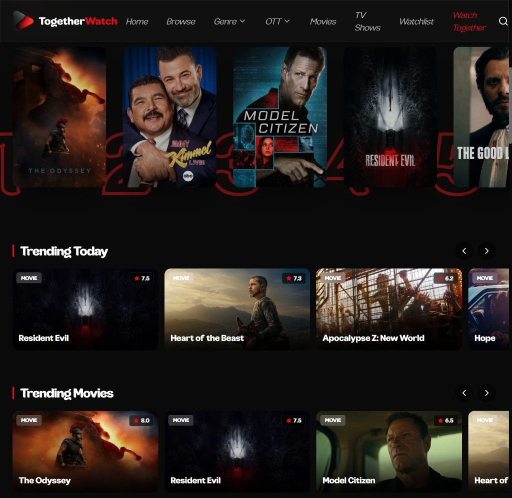
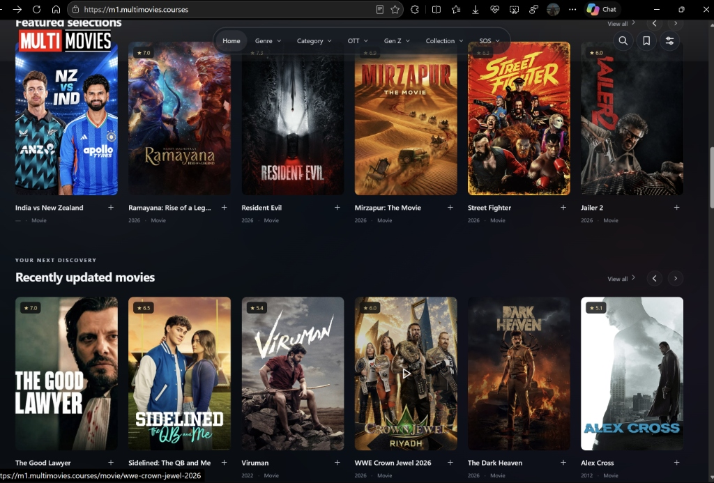
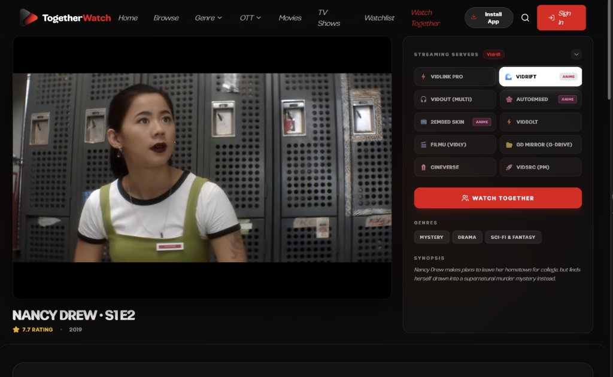
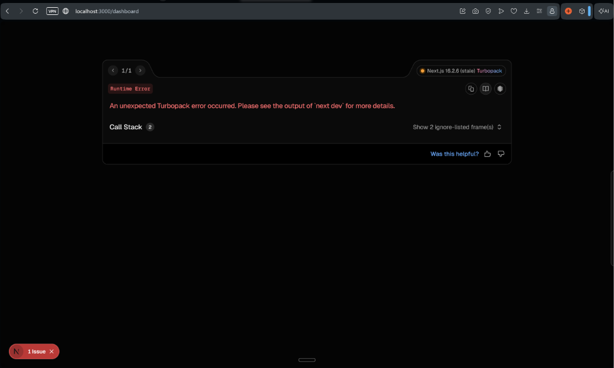
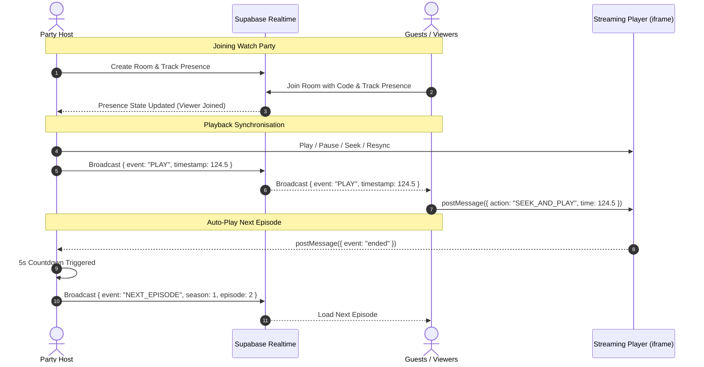

<div align="center">

# 🎬 TogetherWatch

**Next-Generation Synchronized Watch-Party & Cinema Streaming Platform**

An all-in-one cinematic streaming hub and real-time watch-party platform with Netflix-style media discovery, Progressive Web App (PWA) support, automated next-episode progression, 10 high-speed streaming servers, and seamless playhead synchronization.

[](https://togetherwatchit.vercel.app)
[](https://nextjs.org/)
[](https://react.dev/)
[](https://supabase.com/)
[](https://tailwindcss.com/)
[](https://web.dev/progressive-web-apps/)
[](LICENSE)

---

### 🌐 [Explore the Live App](https://togetherwatchit.vercel.app) • [Create a Watch Room](https://togetherwatchit.vercel.app/room/create) • [Browse Movies & Series](https://togetherwatchit.vercel.app/browse)

</div>

---

## 📸 Visual Showcase

<div align="center">

### 🏠 Cinema Discovery Feed & Dynamic Hero Showcase
Dynamic backdrop artwork blur, curated hero carousels, Continue Watching shelf, and native PWA installation prompt.



<br/>

### 🏆 Top 10 Rankings & Portrait Media Rails
Stylized oversized typography rankings, rating badges, release years, and portrait aspect-ratio cards matching modern OTT standards.



<br/>

### 🎥 Cinema Player & Multi-Server Engine
Edge-to-edge theater cinema player, integrated metadata row, collapsible server switcher with 10 stream mirrors, and dedicated season/episode picker.



<br/>

### 👥 Real-Time Synchronized Watch Parties
Supabase Realtime-powered room synchronization, presence indicators, host playhead distribution, live chat, and reaction bursts.



</div>

---

## 🌟 Key Features

### 🎬 1. Netflix-Style Media Discovery
* **Dynamic Backdrop Glassmorphism**: High-resolution TMDB artwork blurs seamlessly into a dark cinema canvas.
* **Top 10 Rankings**: Stylized numeric typography showcasing daily trending movies and TV series.
* **Trending Rails in Portrait Aspect Ratio**: Perfectly formatted 2:3 vertical posters with star ratings, release years, and content type tags.
* **Smart Search & Filters**: Instant full-text search across thousands of movies, TV shows, and anime with genre and category filters.

### 🍿 2. Synchronized Watch Parties
* **Supabase Realtime Broadcast**: Perfect frame-accurate synchronization across host and viewer playheads without screen-sharing lag.
* **Cinematic 3-2-1 Countdown**: Host-triggered synchronized playback countdown so all participants start videos in unison.
* **Live Presence Tracking**: Real-time viewer count and avatar list showing who is currently in the watch room.
* **Interactive Chat & Emoji Bursts**: In-room chat panel with floating reaction bursts and sound effects.
* **Shareable Room Codes**: One-click invite link copying or short 6-character room codes for quick guest entry.

### ⚡ 3. Auto-Play Next Episode Engine
* **Universal Cross-Origin Event Parser**: Listens across cross-origin iframe boundaries to completion signals from **VidLink PRO**, **VidRift**, **AutoEmbed**, and standard HTML5 players.
* **Floating 5-Second Countdown Card**: Netflix-style floating banner at the bottom right with a circular SVG timer, displaying upcoming episode titles.
* **Play Now & Cancel Buttons**: Instant one-tap jump or quick cancellation if the viewer wants to rewatch credits.
* **Automated Season Rollover**: Seamlessly transitions from the season finale (e.g., S1 E8) into the next season premiere (S2 E1) without breaking flow.
* **Persistent Preference**: Remembers the user's on/off toggle choice across sessions in `localStorage`.
* **Quick Prev / Next Controls**: Dedicated navigation buttons in the player metadata bar for instant manual episode jumping.

### 📡 4. Multi-Source Streaming Engine
* **10 Redundant Streaming Mirrors**: Instant switching between 10 verified streaming providers with zero page reloads:
  1. ⚡ **VidLink PRO**: Ultra-fast HD streams with native event bridge & resume tracking.
  2. 🌊 **VidRift**: Adaptive HLS player with multi-subtitle support and dedicated anime streams.
  3. 🎧 **VIDOUT (Multi)**: High-speed Cloudflare-backed player with multiple audio tracks.
  4. 🌸 **AutoEmbed**: Verified aggregator with fast mirrors for movies, TV series, and anime.
  5. 📺 **2Embed Skin**: Clean, lightweight player with extensive catalog mirrors.
  6. 🍡 **VidBolt**: Fast bufferless CDN playback.
  7. 🎬 **Filmu (Vidly)**: Multi-mirror engine with multi-language subtitle tracks.
  8. 📂 **GD Mirror (G-Drive)**: High-speed Google Drive cloud mirrors with dual audio.
  9. 🍿 **Cineverse**: Multi-source aggregator engine.
  10. 🚀 **VidSrc (PM)**: Unblocked, high-speed VidSrc mirror.
* **Server Status & Feature Badges**: Server selector displays helpful indicators like `AUTO-NEXT`, `ANIME`, and `MULTI-AUDIO`.
* **Automatic Server Memory**: Remembers your favorite server and defaults to it for future playback.

### 📱 5. Progressive Web App (PWA)
* **Installable Native App Feel**: Launch TogetherWatch as a standalone borderless app on Windows, macOS, ChromeOS, iOS, and Android.
* **Custom App Icons & Splash Screens**: Maskable HD icons and full-screen window configuration.
* **Offline Resilient**: Integrated Service Worker (`sw.js`) caching core app shell and offline assets.

### ⏱️ 6. Persistent Continue Watching & Progress Resumption
* **Accurate Timestamp Resumption**: Automatically saves playback timestamps every 3 seconds locally in `localStorage` and to Supabase DB for signed-in users.
* **Cross-Episode Memory**: Clicking a Continue Watching banner starts directly from the exact episode and minute where you left off.
* **Episode Badges**: Continue Watching cards prominently display `S1 E7` tags with visual progress bars.

### 🌸 7. Dedicated Anime Hub
* **AniList API Integration**: Direct access to top anime rankings, episode counts, Romanji/English titles, and synopsis previews.
* **Anime-Optimized Streams**: Automatically pairs anime titles with VidRift and AutoEmbed HLS sources.

---

## 🛠️ Tech Stack & Architecture

| Layer | Technologies |
| :--- | :--- |
| **Frontend Framework** | [Next.js 16.2](https://nextjs.org/) (App Router, Turbopack / Webpack, WASM) |
| **Core UI Library** | [React 19](https://react.dev/) |
| **Styling & Design** | [Tailwind CSS 3.4](https://tailwindcss.com/), Custom Gradients, Glassmorphism |
| **State Management** | [Zustand](https://zustand-demo.pmnd.rs/) (Room Sync, Auth, UI, Watchlist) |
| **Realtime & Backend** | [Supabase](https://supabase.com/) (Auth, PostgreSQL, Realtime Broadcast & Presence) |
| **Icons & Typography** | [Lucide React](https://lucide.dev/), Custom Brand Typography |
| **APIs** | [The Movie Database (TMDB)](https://www.themoviedb.org/), [AniList GraphQL](https://anilist.co/) |
| **PWA & Service Worker** | Web App Manifest v2, Service Worker Cache |
| **Hosting & CI/CD** | [Vercel](https://vercel.com/) |

---

## 🔄 Real-Time Watch Party Synchronization Architecture



---

## 🚀 Getting Started

### Prerequisites
* [Node.js](https://nodejs.org/) v18.0.0 or higher
* npm, pnpm, or yarn
* A free [Supabase](https://supabase.com/) project
* A free [TMDB API Key](https://www.themoviedb.org/documentation/api)

### 1. Clone the Repository
```bash
git clone https://github.com/rishabh777dev/togetherwatch.git
cd togetherwatch
```

### 2. Configure Environment Variables
Create a `.env.local` file in the root directory:
```bash
cp .env.example .env.local
```
Fill in your API credentials:
```env
# TMDB API
NEXT_PUBLIC_TMDB_API_KEY=your_tmdb_api_key_here

# Supabase Configuration
NEXT_PUBLIC_SUPABASE_URL=https://your-project.supabase.co
NEXT_PUBLIC_SUPABASE_ANON_KEY=your_supabase_anon_key_here

# Google Drive Mirror Encryption Key (Optional)
NEXT_PUBLIC_GD_KEY=your_encryption_key_here
```

### 3. Install Dependencies
```bash
npm install
```

### 4. Run Development Server
```bash
npm run dev
```
Open [http://localhost:3000](http://localhost:3000) in your browser.

---

## 🗄️ Database Schemas (Supabase)

Execute the following SQL queries in your Supabase SQL Editor to initialize the required tables:

```sql
-- 1. Watch Party Rooms
create table public.rooms (
  id uuid default gen_random_uuid() primary key,
  code text not null unique,
  name text not null,
  host_id text not null,
  host_name text not null,
  host_avatar text,
  media_id text not null,
  media_type text not null check (media_type in ('movie', 'tv')),
  media_title text,
  selected_source text default 'vidlink' not null,
  is_public boolean default false not null,
  started_at timestamp with time zone default timezone('utc'::text, now()) not null,
  created_at timestamp with time zone default timezone('utc'::text, now()) not null
);

-- 2. Real-Time Chat & Emoji Reactions
create table public.messages (
  id uuid default gen_random_uuid() primary key,
  room_code text not null references public.rooms(code) on delete cascade,
  user_id text not null,
  user_name text not null,
  content text not null,
  message_type text default 'message'::text not null check (message_type in ('message', 'reaction', 'system')),
  created_at timestamp with time zone default timezone('utc'::text, now()) not null
);

-- 3. Watch Progress & Resumption
create table public.watch_progress (
  id uuid default gen_random_uuid() primary key,
  user_id text not null,
  media_id text not null,
  media_type text not null check (media_type in ('movie', 'tv')),
  season integer default 0 not null,
  episode integer default 0 not null,
  progress numeric default 0 not null,
  timestamp integer default 0 not null,
  duration integer default 0 not null,
  updated_at timestamp with time zone default timezone('utc'::text, now()) not null
);
```

---

## 📄 License

This project is licensed under the MIT License - see the [LICENSE](LICENSE) file for details.

---

<div align="center">

Made with ❤️ by [rishabh777dev](https://github.com/rishabh777dev) • Star ⭐ the repository if you enjoyed TogetherWatch!

</div>
